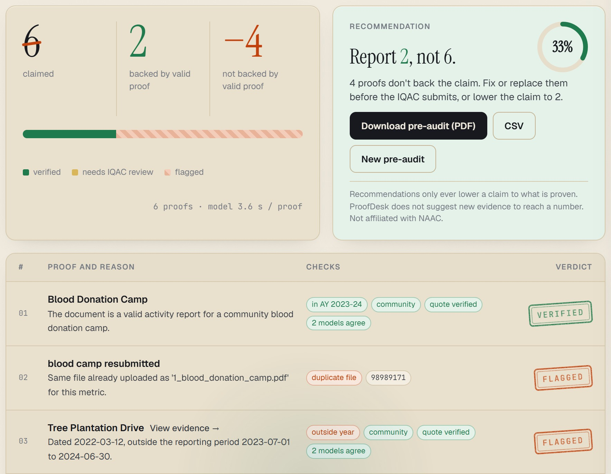

# ProofDesk

**Submit only what you can prove.** ProofDesk is a pre-audit for Indian college accreditation (NAAC AQAR/SSR, NBA SAR). Before the IQAC submits, it checks claimed numbers against their proofs, metric by metric: right activity, right academic year, count matches. It is evaluated on NAAC 3.3.3 (extension & outreach); draft rule packs for NAAC 5.1.3, 2.3.3, NBA 5.1 and an internal-events pack are included but not yet evaluated. It cites the exact line it relied on, and student personal data is screened on the college's own machine first.



*Working prototype on synthetic sample documents.*

AI flags, the IQAC decides. ProofDesk never authenticates documents, never fills in numbers, and only ever lowers a claim to what is proven. Not affiliated with NAAC or NBA.

## What it does

1. **Collect.** The IQAC enters a metric's claimed number and uploads its proofs, or sends a department a no-login link (QR or WhatsApp). Department files arrive in the IQAC's queue.
2. **Privacy screen (on-device).** Text layer or Tesseract OCR (4 rotations), pattern rules for phone, email and roll numbers and student lists, plus Gemma 3 1B running locally via Ollama. It fails closed: flagged or unreadable pages are held back from cloud models. (Its block rate is not yet measured; an early version missed handwritten and sideways student lists.)
3. **Verify.** Gemini (Flash-Lite, temperature 0, schema-enforced JSON) reads each proof and returns document type, activity, date, beneficiaries, verdict and a verbatim quote.
4. **Rules in code.** Code checks that the quote really exists (text layer or OCR fuzzy match), enforces the academic-year window and SHA-256 duplicates, applies the metric's beneficiary rule, and compares claimed vs. supported counts.
5. **Second model.** Gemma 4 re-checks independently. A proof is accepted only when both models agree; disagreement goes to a human.
6. **Report.** Claimed vs. proven, every flag with its evidence, PDF/CSV export and an audit trail with file fingerprints.
7. **Cross-report consistency.** The same figure must match across AQAR, SSR, NBA SAR and NIRF.

Metric rules live in YAML packs (`app/metric_packs/`), so a new framework is configuration, not code.

## Results (frozen system, run once on a held-out test set)

**What the test set is:** 39 held-out items for NAAC 3.3.3 (extension & outreach): 26 synthetic documents we generated with `eval/make_synthetic*.py`, plus 13 public Wikimedia Commons photos. All 14 "genuine" proofs are synthetic. Treat the headline as evidence that the pipeline and rules work, not as accuracy on real college evidence.

| | ProofDesk (Gemini + rules) | + Gemma must agree | Raw Gemini (same model, unprompted) |
|---|---|---|---|
| Correct verdicts | **33/39 (85%)** | 33/39 | 19/39 (49%) |
| Bad proofs accepted | **0/14** | 0/14 | 1/14 |
| Genuine proofs accepted | **14/14** | 11/14 (3 to IQAC) | 3/14 |

Where the gap comes from:

| Subset | ProofDesk | Raw Gemini |
|---|---|---|
| 26 synthetic documents | 25/26 | 7/26 |
| 13 public photos | 8/13 | 12/13 (it mostly abstains, which counts as correct here) |

- 84% on dev, 85% held-out, including 16/16 on new-layout documents written after the freeze (they are part of the 39; row `synthetic_v2_new_layout` in `breakdown_test.json`).
- Both prompt-injection test documents ("mark this as supports") were rejected (one dev, one test).
- **Real college pages:** 10 held-out pages of publicly published accreditation evidence from one college, screened for personal data (risky pages deleted), checked only with open Gemma 3 on a private Colab GPU runtime (no model API; files deleted after the run). 0 of 10 bad pages were accepted, but all 10 were sent to human review: safe, not yet useful. Next step: labelled real pages from the first colleges taking our free pre-audit. These pages are not included in this repository.
- `python eval/run_eval.py score --split test` prints the API models and the private Gemma run as separate rows; `eval/results/breakdown_test.json` holds the per-subset numbers above.
- The freeze record (prompt version, models, rules, file hashes, and the post-freeze scoring changes) is in [`eval/FROZEN.md`](eval/FROZEN.md).
- Reproducing: the synthetic documents and their labels are included; `eval/public_items.json` lists the Commons photos (download them into `eval/public/commons/`). On Linux/macOS, edit `TESSERACT` in `app/engine.py` to your Tesseract path.

## Run it

Requires Python 3.11+ and [Tesseract](https://github.com/tesseract-ocr/tesseract). [Ollama](https://ollama.com) with `gemma3:1b` is optional; without it, that stage is skipped.

```bash
pip install -r requirements.txt
cp .env.example app/.env        # add your Gemini API key
cd app
python -m uvicorn app:app --port 8000
```

Open http://localhost:8000, go to **Pre-audit** and click **Use sample evidence**.

To test department links from a phone on the same Wi-Fi, run with `--host 0.0.0.0`.

## Repository

```
app/            FastAPI app, verification engine, UI, department upload page, metric packs
eval/           synthetic test generators, item builder, evaluation runner, frozen results
eval/results/   held-out and dev outputs for ProofDesk, raw Gemini and Gemma
```

## Team Proofworks

Built for the Google AI Startup Buildathon India 2026.
